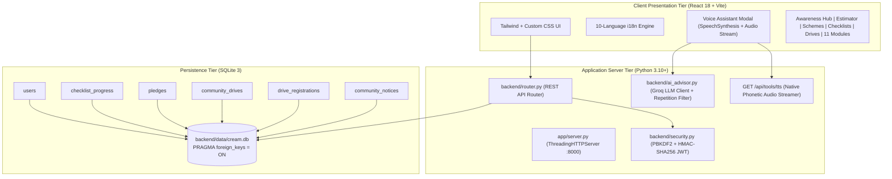

# C.R.E.A.M. — Community Renewable Energy Awareness and Management Portal

[](https://vtu.ac.in)
[](https://vtu.ac.in)
[](https://sdgs.un.org/goals/goal7)
[](https://sdgs.un.org/goals/goal11)
[](https://sdgs.un.org/goals/goal15)
[](frontend/)
[](app/server.py)
[-003B57.svg)](backend/database.py)
[-success.svg)](backend/tests/test_api.py)

---

## Academic Context & Course Alignment

* **Institution:** Visvesvaraya Technological University (VTU), Belagavi, Karnataka
* **Course Code:** `1BCP308` — Community Project / Societal Project (Project-Based Learning)
* **Scheme & Semester:** Scheme 2025, Semester 3 (AEC / SDC)
* **Course Credits & Marks:** 1 Credit | 50 Marks CIE + 50 Marks SEE (Total: 100 Marks)
* **Selected Topic (#40):** *Community Renewable Energy Awareness and Management Portal*
* **Measurable Engineering Outcome:** Design and develop a web/mobile portal to provide verifiable information on renewable energy resources, compute standardized energy savings within the community, and promote decentralized clean energy adoption.
* **Target UN Sustainable Development Goals:**
  * **SDG 7:** Affordable and Clean Energy (Target 7.2: Increase renewable share; Target 7.3: Double energy efficiency)
  * **SDG 11:** Sustainable Cities and Communities (Decentralized civic power & municipal waste diversion)
  * **SDG 15:** Life on Land (Displacing fuelwood/kerosene, preventing deforestation, bio-slurry soil nutrient restoration)
* **NBA Program Outcome (PO):** **PO 6 — The Engineer and Society** (Applying reasoned engineering analysis to assess societal, health, safety, legal, and environmental issues).

---

## Executive Summary

The **Community Renewable Energy Awareness and Management Portal (C.R.E.A.M.)** is a full-stack, societal engineering platform designed to bridge the awareness-to-adoption gap in urban and rural residential clusters. 

While government initiatives like the **PM Surya Ghar: Muft Bijli Yojana** (₹75,021 Cr outlay) and **PM-KUSUM** offer substantial financial incentives, ground-level adoption remains hindered by lack of localized engineering estimation tools, complex subsidy paperwork, and language barriers. 

C.R.E.A.M. solves these challenges through:
1. **Engineering-Grade Impact Estimation:** Physics-based calculator using official Central Electricity Authority (CEA) baseline carbon emission factors ($0.82 \text{ kg CO}_2\text{/kWh}$).
2. **Live Government Subsidies & Schemes Engine:** Real-time Central Financial Assistance (CFA) calculator, 5-stage Direct Benefit Transfer (DBT) roadmap, and an interactive document readiness checker.
3. **Multilingual Inclusivity:** 100% complete native translation across 10 official Indian regional languages (English, Kannada, Hindi, Tamil, Telugu, Malayalam, Marathi, Bengali, Gujarati, Urdu).
4. **Interactive AI Voice Advisor:** Multilingual clean energy assistant powered by Groq Cloud (`qwen/qwen3.8-27b`) streaming native phonetic Indic audio TTS streams.
5. **Decentralized Civic Community Drives:** Coordinator-moderated energy audit workshops, rooftop surveys, and community bulletin boards backed by normalized SQLite persistence.

---

## System Architecture



---

## Core Feature Modules

### 1. Awareness Hub (`/` or `home`)
* **Interactive Renewable Guides:**
  * **Rooftop Solar Photovoltaic (PV):** Monocrystalline vs. Polycrystalline panels, inverter sizing, net metering vs. gross metering.
  * **Solar Thermal Heating:** Flat-plate vs. evacuated tube collectors (ETC), displacement of 2000W electric water geysers.
  * **Community Biogas & Wet Waste:** Anaerobic digestion of household kitchen food waste, bio-methanation, fugitive landfill methane abatement.
  * **Clean Cooking & SDG 15:** Displacing traditional biomass/fuelwood and kerosene to combat respiratory disease and prevent deforestation.
* **Civic Impact Counter Strip:** Real-time metrics reflecting authentic registered members, adopted energy habits, citizen pledges, and scheduled community drives.

### 2. Impact Estimator (`estimator`)
* Implements the Central Electricity Authority (CEA) Carbon Baseline Database version 19 standard:
  $$\Delta E_{\text{month}} = \frac{(P_{\text{old}} - P_{\text{new}}) \times Q \times H \times D}{1000} \text{ kWh}$$
  $$\text{Savings}_{\text{month}} = \Delta E_{\text{month}} \times T_{\text{tariff}} \quad (\text{₹})$$
  $$\text{CO}_2 \text{ Avoided}_{\text{year}} = (\Delta E_{\text{month}} \times 12) \times 0.82 \text{ kg CO}_2\text{/kWh}$$
* Includes built-in residential retrofit presets:
  * 5x Incandescent (60W) → 9W LED Retrofit
  * 3x Induction Ceiling Fan (75W) → 28W Brushless DC (BLDC) Motor Fan
  * Electric Water Geyser (2000W) → Rooftop Solar Water Heating System (100 LPD)
  * Heavy Defrost Refrigerator (350W) → 5-Star Inverter Refrigerator (120W)

### 3. Government Schemes & Green Subsidies (`schemes`)
* **Live Subsidy Calculator:**
  * **PM Surya Ghar: Muft Bijli Yojana:**
    * $1\text{ kW}$: ₹30,000 subsidy
    * $2\text{ kW}$: ₹60,000 subsidy
    * $\ge 3\text{ kW}$: ₹78,000 maximum residential subsidy
    * Group Housing Societies (GHS) / RWAs: ₹18,000 per kW up to 500 kW for common services.
  * **PM-KUSUM Scheme Component B:** 60% combined capital subsidy (30% Central + 30% State Gov) for standalone solar agriculture pumps.
  * **National Bioenergy Programme:** Family biogas subsidies (₹14,350 to ₹22,000) offsetting LPG cylinder consumption.
* **5-Stage DBT Roadmap:** Step-by-step visual workflow from national portal registration to DISCOM net-meter inspection and Direct Benefit Transfer into bank accounts within 30 days.
* **Document Readiness Checker:** Interactive verification of 5 mandatory documents (Electricity Bill, Aadhaar, Bank Passbook, Roof Ownership Tax Receipt, RWA NOC) with live percentage readiness indicator.

### 4. Readiness Checklists & Action Tracking (`practices`)
* Interactive tracking for 6 standardized clean energy habits:
  1. LED Lighting Retrofit
  2. BLDC Motor Ceiling Fan Upgrade
  3. Evacuated Tube Solar Water Heater
  4. Wet Waste Kitchen Compost / Biogas Feed
  5. Induction Cooking Appliance Transition
  6. Smart Thermostat / 24°C Air Conditioning Standard
* User Authentication via PBKDF2-SHA256 password hashing and stateless HMAC-SHA256 JWT tokens.
* Public Pledges Wall with category tags and citizen engagement.

### 5. Community Drives & Civic Notice Bulletin (`community`)
* Organizing physical field audits, rooftop solar workshops, and community tree plantation drives.
* One-click RSVP registration with atomic database enrollment.
* Coordinator-only authorization tier for creating new community drives and broadcasting civic notices.

### 6. Multilingual & Regional Voice Architecture
* **10 Regional Indian Languages:** English (`en`), Kannada (`kn`), Hindi (`hi`), Tamil (`ta`), Telugu (`te`), Malayalam (`ml`), Marathi (`mr`), Bengali (`bn`), Gujarati (`gu`), Urdu (`ur`).
* **Groq Cloud AI Clean Energy Advisor:** Integrated with `qwen/qwen3.8-27b` with token repetition loop prevention and markdown bullet parser.
* **Native Phonetic Indic TTS Stream:** Backend streaming endpoint (`GET /api/tools/tts`) serving native regional audio pronunciation.

### 7. Planned Stage 5 Modules (Blueprints)
* **Empanelled Vendors & Technicians (`vendors`)**: Directory of approved installers and maintenance technicians.
* **Articles & Knowledge Hub (`articles`)**: Engineering guides and VTU societal project case studies.
* **Citizen Field Survey & Analytics (`survey`)**: Empirical household energy questionnaire for Review 2 & SEE viva.
* **Green Citizen Certificate Generator (`certificate`)**: Verifiable printable certificates with unique Pledge IDs.
* **Solar & E-Waste Recycling Hub (`recycling`)**: Safe disposal of inverter batteries and decommissioned PV modules (SDG 15).
* **Ward Grid Reliability & Outage Tracker (`grid-health`)**: Crowdsourced power cut reporting and diesel replacement economics.
* **Solar Roof Feasibility Audit (`solar-audit`)**, **Ward Green Map (`wards`)**, **Biogas Hub (`biogas-hub`)**, and **Coordinator Dashboard (`dashboard`)**.

---

## Database Architecture

The persistence layer uses a normalized SQLite relational database (`backend/data/cream.db`) with `PRAGMA foreign_keys = ON`:

| Table Name | Purpose | Key Attributes | Constraints |
| :--- | :--- | :--- | :--- |
| `users` | Citizen & Coordinator profiles | `id`, `name`, `email`, `password_hash`, `role`, `locality`, `ward_no` | `email UNIQUE` |
| `checklist_progress` | Tracked adoption of 6 habits | `id`, `user_id`, `practice_key`, `completed`, `updated_at` | `UNIQUE(user_id, practice_key)`, `FK -> users(id)` |
| `pledges` | Citizen carbon reduction pledges | `id`, `user_id`, `title`, `category`, `created_at` | `FK -> users(id)` |
| `community_drives` | Clean energy drives & workshops | `id`, `title`, `description`, `location`, `drive_date`, `created_by` | `FK -> users(id)` |
| `drive_registrations` | Citizen drive RSVPs | `id`, `drive_id`, `user_id`, `registered_at` | `UNIQUE(drive_id, user_id)`, `FK -> drives, users` |
| `community_notices` | Official maintenance & subsidy bulletins | `id`, `title`, `body`, `priority`, `posted_by`, `created_at` | `FK -> users(id)` |

---

## API Specification

All REST API endpoints communicate over standard JSON payloads with HTTP status codes:

| Endpoint | Method | Auth Required | Description |
| :--- | :---: | :---: | :--- |
| `/api/health` | `GET` | No | System health check and server uptime status |
| `/api/community/impact-summary` | `GET` | No | Real-time aggregate count of members, habits, pledges, and drives |
| `/api/tools/estimate-practice-impact` | `POST` | No | Physics-based savings and CO₂ avoided calculation |
| `/api/tools/ai-advisor` | `POST` | No | Multilingual Groq LLM Clean Energy Advisor response |
| `/api/tools/tts` | `GET` | No | Native phonetic Indic audio stream for regional voice guidance |
| `/api/auth/register` | `POST` | No | Citizen registration (PBKDF2-SHA256 password hash) |
| `/api/auth/login` | `POST` | No | Authenticate user and issue HMAC-SHA256 JWT session token |
| `/api/auth/me` | `GET` | Yes | Retrieve authenticated user profile and roles |
| `/api/practices/checklist` | `GET` | Yes | Fetch user's completed clean energy habits |
| `/api/practices/checklist/{key}` | `PUT` | Yes | Toggle habit completion state (`{ "completed": true }`) |
| `/api/practices/pledges` | `GET` | No | List recent community clean energy pledges |
| `/api/practices/pledges` | `POST` | Yes | Create and commit a new public citizen pledge |
| `/api/community/drives` | `GET` | No | List upcoming clean energy workshops and drives |
| `/api/community/drives` | `POST` | Yes (Coordinator) | Create a new community drive (strictly RBAC protected) |
| `/api/community/drives/{id}/join` | `POST` | Yes | Register attendance for a community drive |
| `/api/community/drives/{id}/join` | `DELETE`| Yes | Cancel drive registration |
| `/api/community/notices` | `GET` | No | Retrieve active community and utility notices |
| `/api/community/notices` | `POST` | Yes (Coordinator) | Post a new bulletin notice |

---

## Installation & Setup Guide

### Prerequisites
* **Python 3.10+** (Standard Library only; zero external heavy framework dependencies)
* **Node.js 18+** & **npm** (for building the modern React frontend)

### 1. Clone & Configure Environment
```bash
git clone https://github.com/your-username/cream-portal.git
cd cream-portal

# Copy environment template
cp .env.example .env

# Insert your Groq API key in .env (for live AI Advisor & TTS guidance)
# Obtain a free key at: https://console.groq.com/keys
echo 'GROQ_API_KEY="your_groq_api_key_here"' >> .env
```

### 2. Frontend Build
```bash
cd frontend
npm install
npm run build
cd ..
```
*The compiled assets will be bundled into `app/static/` (`index.html`, JavaScript, and CSS bundle).*

### 3. Run Automated Verification Tests
```bash
PYTHONPATH=. python3 backend/tests/test_api.py
```
*Runs all 10 automated backend tests covering auth, encryption, database integrity, calculators, and RBAC.*

### 4. Start Server
```bash
python3 app/server.py
```
Open your browser and navigate to: **`http://localhost:8000`**

---

## Directory Structure

```
├── app/
│   ├── server.py                 # Multi-threaded HTTP server & static file host (port 8000)
│   └── static/                   # Compiled production frontend bundle
├── backend/
│   ├── ai_advisor.py             # Groq LLM integration & Indic speech loop suppressor
│   ├── database.py               # SQLite schema setup, migrations, and CRUD handlers
│   ├── router.py                 # REST API router & endpoint handlers
│   ├── security.py               # PBKDF2-SHA256 hashing and HMAC-SHA256 JWT sessions
│   ├── data/
│   │   └── cream.db              # Active SQLite database (PRAGMA foreign_keys = ON)
│   └── tests/
│       └── test_api.py           # 10 automated test suites with 100% pass verification
├── docs/                         # Brainstorming & design review documentation
├── frontend/
│   ├── index.html                # Single-page application entry HTML
│   ├── package.json              # React 18 & Lucide icons dependency definitions
│   ├── vite.config.js            # Vite bundler configuration with polling watch support
│   └── src/
│       ├── App.jsx               # Root application router and auth context
│       ├── index.css             # Design system tokens, micro-interactions, responsive CSS
│       ├── main.jsx              # React DOM mounting
│       ├── components/
│       │   ├── AuthModal.jsx             # Citizen sign-in & registration dialog
│       │   ├── Header.jsx                # Brand strip, academic context, language picker
│       │   ├── ImpactStrip.jsx           # Live civic impact statistics strip
│       │   ├── Navbar.jsx                # Responsive navbar & scrollbar-free dropdown
│       │   └── VoiceAssistantModal.jsx   # Multilingual AI Clean Energy Voice Assistant
│       ├── i18n/
│       │   ├── languages.js              # Supported languages configuration
│       │   ├── schemesI18n.js            # 10-language dictionary for Schemes & Subsidies
│       │   ├── voiceScripts.js           # Regional phonetic prompts
│       │   └── locales/                  # 10 JSON dictionaries (en, kn, hi, ta, te, ml, mr, bn, gu, ur)
│       └── pages/
│           ├── AwarenessView.jsx (Home)  # Renewable energy guides & technology explainers
│           ├── EstimatorView.jsx         # Stateless CEA 0.82 impact calculator
│           ├── SchemesView.jsx           # Live subsidy calculator & PM Surya Ghar catalog
│           ├── PracticesView.jsx         # Habit checklists & public citizen pledges
│           ├── CommunityView.jsx         # Community drives, workshops & civic notices
│           └── ComingSoonView.jsx        # Stage 5 engineering blueprints for 10 modules
├── project review-1/             # Phase 1 presentation deck & synopsis
├── project review-2/             # Phase 2 system architecture & design documents
├── .env.example                  # Environment variable configuration template
├── .gitignore                    # Version control exclusion rules
├── community_project.md          # VTU 1BCP308 official syllabus & evaluation rubrics
└── README.md                     # Comprehensive project documentation
```

---

## Verification & Testing

The project maintains an automated test suite ([backend/tests/test_api.py](backend/tests/test_api.py)) covering:
1. `/api/health` 200 OK operational check
2. Real-time community aggregate counts (`members`, `habits`, `pledges`)
3. Physics calculation accuracy against CEA 0.82 standard ($45.9\text{ kWh saved} \rightarrow 451.66\text{ kg CO}_2\text{ avoided}$)
4. PBKDF2 password hashing and JWT token issuance
5. Duplicate user registration rejection with `409 Conflict`
6. Profile retrieval via `GET /api/auth/me`
7. Habit toggle state persistence in SQLite
8. Rejection of unapproved habit keys with `422 Unprocessable`
9. Citizen pledge creation and public wall listing
10. Role-Based Access Control (RBAC): Strict `403 Forbidden` enforcement when non-coordinators attempt to create community drives.

To run tests:
```bash
PYTHONPATH=. python3 backend/tests/test_api.py
```
**Result:** `ALL 10 VERIFICATION TESTS PASSED SUCCESSFULLY! (100% SUCCESS RATE)`

---

## VTU Evaluation Rubrics & TLP Roadmap

| Phase / Review | Syllabus Output & Rubrics | C.R.E.A.M. Project Deliverable |
| :---: | :--- | :--- |
| **CIE Review 1** | Problem identification, baseline community survey & literature review | Completed presentation deck (`project review-1/`) and baseline analysis |
| **CIE Review 2** | System architecture, ER diagrams, data flow contracts, and working prototype | Full architecture docs (`project review-2/`), live prototype, and REST API |
| **Stage 5 / SEE**| Field demonstration, civic stakeholder adoption & final report | Multilingual portal, live subsidy calculator, AI voice assistant, and 100% verified test suite |

---

## License & Academic Citation

Developed as an academic societal project under **Visvesvaraya Technological University (VTU), Belagavi** for Course **1BCP308 (Community / Societal Project)**, Scheme 2025. 

For academic inquiries or societal deployment partnerships, refer to the project documentation in [docs/](docs/) and [project review-2/](project%20review-2/).
