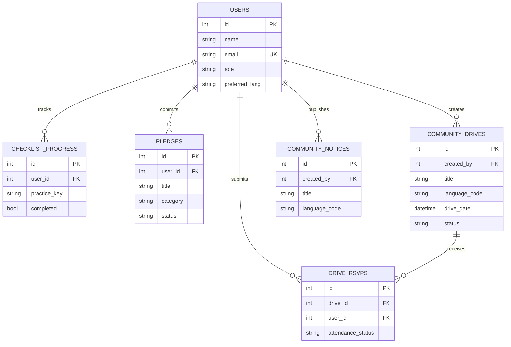
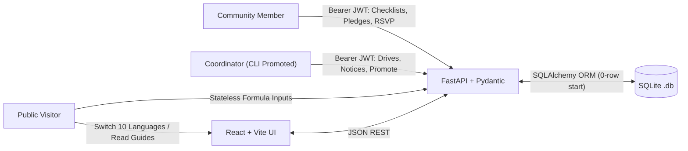

# Topic #40: Detailed System Design (Finalized)

> **Status:** Detailed System Design Finalized (Ready for Review & Implementation Planning)  
> **Builds On:** [brainstorming-design-and-analysis.md](brainstorming-design-and-analysis.md) | [brainstorming-tools-and-technology.md](brainstorming-tools-and-technology.md)  
> **Data Integrity Rule:** [.agents/rules/no-dummy-data.md](../.agents/rules/no-dummy-data.md)

---

## 1. Locked Architectural Baseline

- **Stack:** `React (Vite) + Tailwind CSS` | `FastAPI + Uvicorn + Pydantic` | `SQLite + SQLAlchemy`
- **Access Roles:** Public Visitor (no login) | Community Member (public sign-up → `member`) | Coordinator (CLI/Admin promotion only)
- **Database Tables (`0` initial rows):** `users`, `checklist_progress`, `pledges`, `community_drives`, `drive_rsvps`, `community_notices`
- **Secondary Utility:** Practice & Habit Impact Estimator (`appliance_watt_shift`, `solar_water_heater_shift`)

---

## 2. Area 1: Multilingual & Knowledge Content Design *(Locked)*

- **Chosen Design:** **Frontend Modular Locale JSONs + Shared `practice_key` Allowlist on Backend**.
- **Structure:**
  - `frontend/src/i18n/locales/{en,kn,hi,ta,te,ml,mr,bn,gu,pa}.json` (lazy-loaded per active language with `en` fallback so no raw translation key ever leaks).
  - Static verified reference registry for **Guides** (Solar, Biogas & Waste-to-Energy, Clean Cooking / SDG 15, Energy Conservation), **Simplified Schemes** (with official outbound links), and **Checklist Definitions** (keyed by immutable IDs like `solar_roof_check`, `led_bulb_shift`, `clean_cooking_biogas`).
  - Backend stores only language-independent `practice_key` values (validated against a shared Python allowlist), while coordinator-created `community_drives` and `community_notices` store a `language_code` alongside their authored text.

---

## 3. Area 2: Exact Database Schema & Integrity Rules *(Locked)*

> All 6 tables start at **`0` rows** on initial database creation. Foreign keys are enforced (`PRAGMA foreign_keys=ON` in SQLite).
> The secondary **Practice Impact Estimator** remains **stateless** (no 7th DB table), and all public Impact counters derive strictly via live SQL `COUNT(*)` queries.

### 3.1 Table Definitions
1. **`users`**
   - `id` (INTEGER PK), `name` (TEXT NOT NULL), `email` (TEXT NOT NULL UNIQUE, indexed), `password_hash` (TEXT NOT NULL)
   - `role` (TEXT NOT NULL DEFAULT `'member'` — `'member' | 'coordinator'`)
   - `preferred_lang` (TEXT NOT NULL DEFAULT `'en'` — one of the 10 supported locale codes)
   - `community_area` (TEXT NULL), `created_at` (DATETIME NOT NULL)
2. **`checklist_progress`**
   - `id` (INTEGER PK), `user_id` (FK → `users.id` ON DELETE CASCADE), `practice_key` (TEXT NOT NULL), `completed` (BOOLEAN NOT NULL DEFAULT 0), `updated_at` (DATETIME NOT NULL)
   - Constraint: `UNIQUE(user_id, practice_key)`
3. **`pledges`**
   - `id` (INTEGER PK), `user_id` (FK → `users.id` ON DELETE CASCADE), `practice_key` (TEXT NULL)
   - `title` (TEXT NOT NULL), `category` (TEXT NOT NULL: `'solar' | 'biogas_clean_cooking' | 'conservation'`)
   - `status` (TEXT NOT NULL DEFAULT `'planned'`: `'planned' | 'in_progress' | 'adopted'`)
   - `notes` (TEXT NULL), `created_at` (DATETIME NOT NULL), `updated_at` (DATETIME NOT NULL)
4. **`community_drives`**
   - `id` (INTEGER PK), `created_by` (FK → `users.id`), `title` (TEXT NOT NULL), `description` (TEXT NOT NULL)
   - `language_code` (TEXT NOT NULL DEFAULT `'en'`), `drive_date` (DATETIME NOT NULL), `location` (TEXT NOT NULL)
   - `topic_category` (TEXT NOT NULL: `'solar' | 'biogas_clean_cooking' | 'conservation' | 'general'`)
   - `status` (TEXT NOT NULL DEFAULT `'upcoming'`: `'upcoming' | 'completed' | 'cancelled'`), `created_at` (DATETIME NOT NULL)
5. **`drive_rsvps`**
   - `id` (INTEGER PK), `drive_id` (FK → `community_drives.id` ON DELETE CASCADE), `user_id` (FK → `users.id` ON DELETE CASCADE)
   - `attendance_status` (TEXT NOT NULL DEFAULT `'going'`: `'going' | 'attended'`), `created_at` (DATETIME NOT NULL)
   - Constraint: `UNIQUE(drive_id, user_id)` *(prevents duplicate RSVP inflation)*
6. **`community_notices`**
   - `id` (INTEGER PK), `created_by` (FK → `users.id`), `title` (TEXT NOT NULL), `body` (TEXT NOT NULL)
   - `language_code` (TEXT NOT NULL DEFAULT `'en'`), `created_at` (DATETIME NOT NULL)

### 3.2 Coordinator Bootstrap Flow
- Public `POST /api/auth/register` always creates `role = 'member'`.
- First Coordinator is promoted using a backend CLI command (`python -m app.cli promote-coordinator --email <user@example.com>`) after the real coordinator registers—keeping the DB free of hardcoded/fake admin accounts. Once promoted, a Coordinator can also promote another existing Member via an admin endpoint.

### 3.3 Locked Design Decisions for Area 2
- [x] **6-Table SQLite Schema:** `users`, `checklist_progress`, `pledges`, `community_drives`, `drive_rsvps`, `community_notices` (`0` initial rows, strict unique & FK constraints).
- [x] **Stateless Estimator & Live SQL Counts:** `/estimator` runs statelessly without a DB table; public Impact Summary runs live `COUNT(*)` queries.

---

## 4. Area 3: REST API Contracts, JWT Auth & Error Handling *(Under Discussion)*

### 4.1 Planned API Endpoints (`/api/...`)
1. **Auth (`/api/auth`):**
   - `POST /register` (creates `member`, returns JWT; `409` on duplicate email)
   - `POST /login` (verifies `bcrypt`, returns JWT; `401` on invalid credentials)
   - `GET /me` *(Auth)*, `PATCH /me/language` *(Auth)*
2. **Personal Practices (`/api/practices` — `Member` or `Coordinator`):**
   - `GET /checklist`, `PUT /checklist/{practice_key}` *(validates `practice_key` against shared allowlist; `422` if unknown)*
   - `GET /pledges`, `POST /pledges`, `PATCH /pledges/{id}`, `DELETE /pledges/{id}` *(ownership checked; `403` otherwise)*
3. **Community Drives, Notices & Impact (`/api/community`):**
   - *Public:* `GET /impact-summary` *(live `COUNT(*)` starting at `0`)*, `GET /drives`, `GET /notices`
   - *Member+:* `POST /drives/{id}/rsvp`, `DELETE /drives/{id}/rsvp`
   - *Coordinator Only (`403` for `member`):* `POST /drives`, `PATCH /drives/{id}`, `POST /notices`, `DELETE /notices/{id}`, `POST /users/{id}/promote`
4. **Secondary Practice Impact Estimator (`/api/tools` — Public, Stateless):**
   - `POST /estimate-practice-impact`
   - Validates `old_watts > new_watts >= 0`, `quantity >= 1`, `0 < hours_per_day <= 24`, `1 <= days_per_month <= 31`, `tariff_per_kwh > 0`
   - Returns `{ monthly_kwh_saved, monthly_cost_saved, annual_kwh_saved, annual_cost_saved, formula_display }`

### 4.2 Locked Decision for Area 3
- [x] **JWT Token Transport:** `Authorization: Bearer <jwt>` header (clean cross-origin Vite ↔ FastAPI support and direct Swagger UI `/docs` testing).

---

## 5. Area 4: UI Navigation, `0`-Row Empty States & System Diagrams *(Locked)*

### 5.1 Mobile-First 5-Screen Layout & Empty-State Rules
- **Global Top Shell:** Brand + **10-Language Selector Dropdown** + `Sign In / Account` (collapses cleanly to hamburger menu on mobile `375px`).
- **1. `/` — Awareness Hub:** Category tabs (*Solar, Biogas & Waste-to-Energy, Clean Cooking / SDG 15, Conservation, Simplified Schemes*) + Live Community Impact strip (`0` initially).
- **2. `/practices` — Checklists & Pledges:** Public visitors read steps freely with a sign-in prompt to save; Members toggle checklist items and track pledges (`planned → in_progress → adopted`).
- **3. `/community` — Drives & Notices:** Lists drives & coordinator notices. When SQLite has `0` rows, renders an honest empty state (*"No awareness drives scheduled yet"* + Coordinator `"Create Drive"` button—never placeholder/mock cards).
- **4. `/estimator` — Practice Impact Estimator *(Secondary Tool)*:** Clean user-input form (no pre-filled fake defaults; clear placeholder hints only) displaying exact monthly/annual savings and the transparent formula used.
- **5. `/account` — Sign In / Register & Coordinator Console:** Public sign-up (`member` only); Coordinators unlock tabs for Drive management, Notice publishing, and Member promotion.

### 5.2 System Diagrams (ER & Role Data Flow)

### 5.3 Locked Decision for Area 4
- [x] **UI Visual Theme & Accessibility:** Light high-contrast **Civic-Green & Navy** theme (`#F8FAFC` background, `#0B3C6D` navy headers, `#15803D`/`#16A34A` green accents, `16px+` readable body text, clear Lucide icons) with honest `0`-row empty states.
