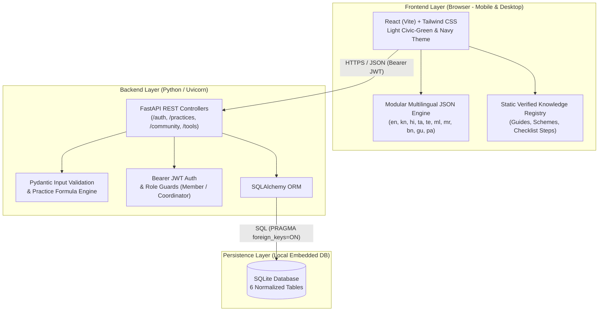

# Chapter 1: System Architecture & Technology Stack

**Project Title:** Community Renewable Energy Awareness and Management Portal  
**Course Code:** VTU 1BCP308 — Community / Societal Project  

---

## 1.1 High-Level 3-Tier Architecture

---

## 1.2 Technology Stack Specification

| Layer | Technology | Purpose & Role |
| :--- | :--- | :--- |
| **Frontend UI** | **React + Vite + Tailwind CSS** | Mobile-first responsive SPA across 5 clean screens |
| **Icons & Visuals** | **Lucide Icons** | Clear visual symbols for energy topics and status cues |
| **Localization** | **Modular JSON Dictionaries (`i18n`)** | Instant multi-language switching across 10 languages with English fallback |
| **Backend API** | **FastAPI + Uvicorn (Python)** | High-speed REST API with auto-generated Swagger `/docs` |
| **Validation** | **Pydantic** | Strict schema checks for forms and estimator physics inputs |
| **Database & ORM** | **SQLite + SQLAlchemy** | Zero-config single-file relational database for real user records |
| **Authentication** | **`bcrypt` / `passlib` + `PyJWT`** | Password hashing and `Authorization: Bearer <jwt>` sessions |
| **Testing & QA** | **`pytest` + FastAPI `TestClient`** | Automated RBAC, CRUD, empty-state, and formula tests |
| **Field & Docs** | **Google Forms, Git/GitHub, Draw.io** | Baseline survey (**O1**), usability feedback (**O5**), version control |

