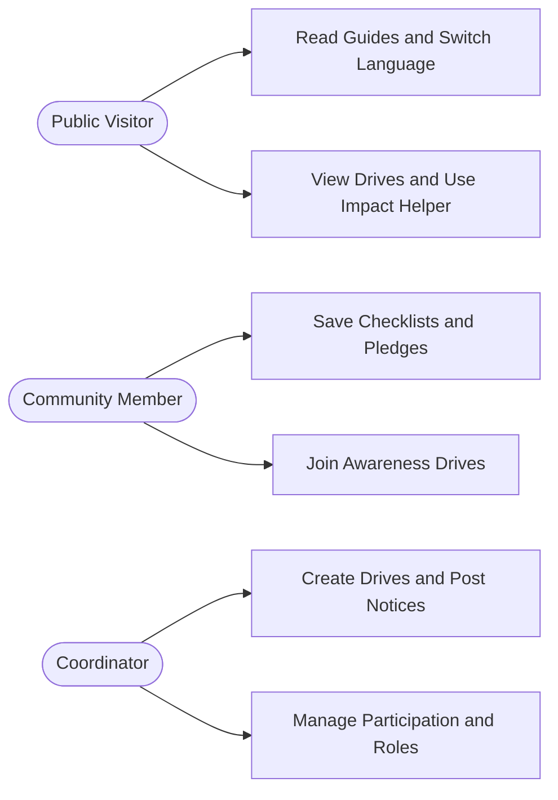
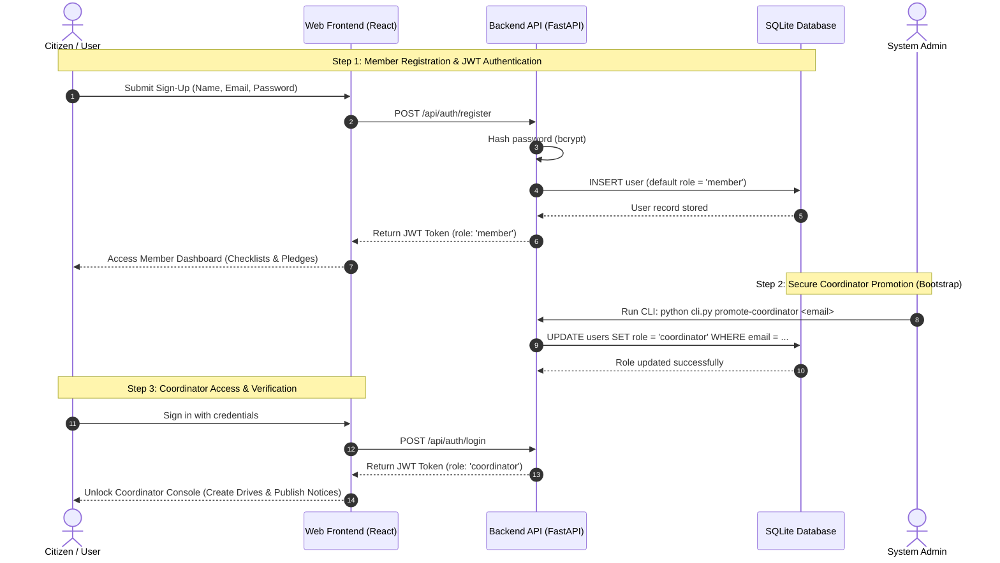

# Chapter 2: Role-Based Access & Use Case Design

**Project Title:** Community Renewable Energy Awareness and Management Portal  
**Course Code:** VTU 1BCP308 — Community / Societal Project  

---

## 2.1 Use Case Diagram

---

## 2.2 Role & Security Rules

| Role | How Assigned | What They Can Do | Restricted From |
| :--- | :--- | :--- | :--- |
| **Public Visitor** | Open access (no login) | Read guides, switch language, view drives, use Impact Helper | Saving pledges, joining drives, creating drives |
| **Community Member** | Public sign-up (`member` role) | All Visitor features + save checklists/pledges & join drives | Creating drives, posting notices, promoting users |
| **Coordinator** | Admin CLI or Coordinator promotion | All Member features + create drives, post notices, promote members | Hardcoded admin logins (disabled by design) |

---

## 2.3 Auth & Coordinator Bootstrap Sequence

**Key Security Design Principles:**
- **Zero Default Passwords:** The system avoids insecure hardcoded admin accounts (such as `admin/admin`). All public registrations are assigned the `member` role by default.
- **Controlled Promotion:** Trusted community volunteers are promoted to `coordinator` through the administrative CLI or by an active Coordinator.
- **Stateless Bearer JWT:** User roles are cryptographically signed within the JSON Web Token (`Authorization: Bearer <jwt>`), ensuring instantaneous, tamper-proof role verification on every API call.

