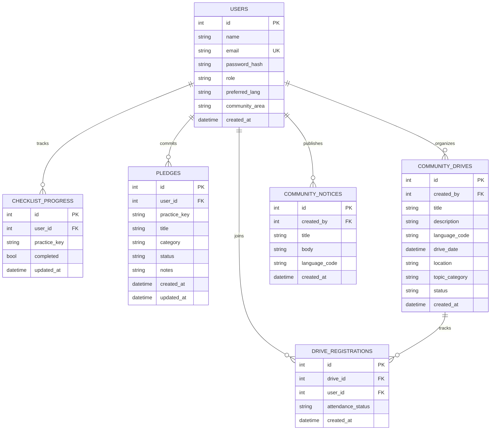

# Chapter 3: Database Design (ER Diagram & Data Dictionary)

**Project Title:** Community Renewable Energy Awareness and Management Portal  
**Course Code:** VTU 1BCP308 — Community / Societal Project  

---

> The SQLite database initializes cleanly with normalized relational tables (populated strictly via authentic user submissions) and enforces `PRAGMA foreign_keys = ON`.

## 3.1 Entity-Relationship Diagram

---

## 3.2 Table Specifications & Constraints

1. **`users`**
   - `id` (`INTEGER PK`), `name` (`TEXT NOT NULL`), `email` (`TEXT NOT NULL UNIQUE`, indexed), `password_hash` (`TEXT NOT NULL`)
   - `role` (`TEXT NOT NULL DEFAULT 'member'` — `'member' | 'coordinator'`)
   - `preferred_lang` (`TEXT NOT NULL DEFAULT 'en'` — `'en' | 'kn' | 'hi' | 'ta' | 'te' | 'ml' | 'mr' | 'bn' | 'gu' | 'pa'`)
   - `community_area` (`TEXT NULL`), `created_at` (`DATETIME NOT NULL`)
2. **`checklist_progress`**
   - `id` (`INTEGER PK`), `user_id` (`INTEGER FK → users.id ON DELETE CASCADE`), `practice_key` (`TEXT NOT NULL`), `completed` (`BOOLEAN NOT NULL DEFAULT 0`), `updated_at` (`DATETIME NOT NULL`)
   - **Constraint:** `UNIQUE(user_id, practice_key)` *(prevents duplicate entries per checklist step)*
3. **`pledges`**
   - `id` (`INTEGER PK`), `user_id` (`INTEGER FK → users.id ON DELETE CASCADE`), `practice_key` (`TEXT NULL`)
   - `title` (`TEXT NOT NULL`), `category` (`TEXT NOT NULL` — `'solar' | 'biogas_clean_cooking' | 'conservation'`)
   - `status` (`TEXT NOT NULL DEFAULT 'planned'` — `'planned' | 'in_progress' | 'adopted'`)
   - `notes` (`TEXT NULL`), `created_at` (`DATETIME NOT NULL`), `updated_at` (`DATETIME NOT NULL`)
4. **`community_drives`**
   - `id` (`INTEGER PK`), `created_by` (`INTEGER FK → users.id`), `title` (`TEXT NOT NULL`), `description` (`TEXT NOT NULL`)
   - `language_code` (`TEXT NOT NULL DEFAULT 'en'`), `drive_date` (`DATETIME NOT NULL`), `location` (`TEXT NOT NULL`)
   - `topic_category` (`TEXT NOT NULL` — `'solar' | 'biogas_clean_cooking' | 'conservation' | 'general'`)
   - `status` (`TEXT NOT NULL DEFAULT 'upcoming'` — `'upcoming' | 'completed' | 'cancelled'`), `created_at` (`DATETIME NOT NULL`)
5. **`drive_registrations`**
   - `id` (`INTEGER PK`), `drive_id` (`INTEGER FK → community_drives.id ON DELETE CASCADE`), `user_id` (`INTEGER FK → users.id ON DELETE CASCADE`)
   - `attendance_status` (`TEXT NOT NULL DEFAULT 'going'` — `'going' | 'attended'`), `created_at` (`DATETIME NOT NULL`)
   - **Constraint:** `UNIQUE(drive_id, user_id)` *(prevents duplicate join-count inflation)*
6. **`community_notices`**
   - `id` (`INTEGER PK`), `created_by` (`INTEGER FK → users.id`), `title` (`TEXT NOT NULL`), `body` (`TEXT NOT NULL`)
   - `language_code` (`TEXT NOT NULL DEFAULT 'en'`), `created_at` (`DATETIME NOT NULL`)

---

## 3.3 Live Impact Summary Aggregation

`GET /api/community/impact-summary` computes all public community metrics dynamically via live SQL `COUNT(*)` queries:
- `total_members` = `COUNT(users)`
- `completed_checklist_items` = `COUNT(checklist_progress WHERE completed = True)`
- `active_pledges` = `COUNT(pledges WHERE status IN ('planned', 'in_progress'))`
- `adopted_practices` = `COUNT(pledges WHERE status = 'adopted')`
- `upcoming_drives` = `COUNT(community_drives WHERE status = 'upcoming')`
- `completed_drives` = `COUNT(community_drives WHERE status = 'completed')`
- `total_attendees` = `COUNT(drive_registrations)`

