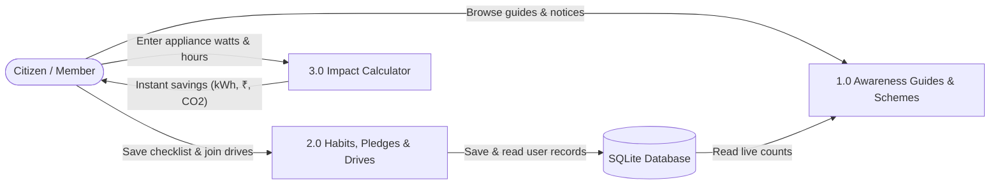
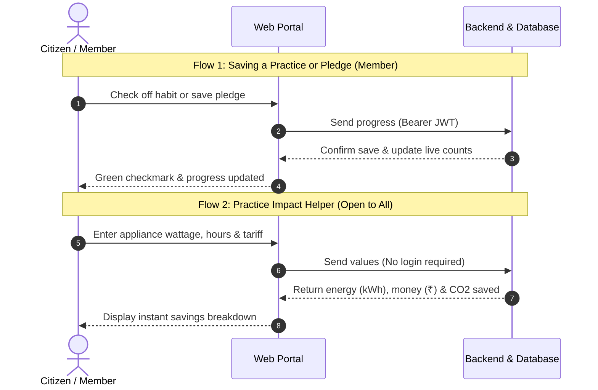

# Chapter 4: Data Flow, API Contracts & Formula Engine

**Project Title:** Community Renewable Energy Awareness and Management Portal  
**Course Code:** VTU 1BCP308 — Community / Societal Project  

---

## 4.1 Level-1 Data Flow Diagram (DFD)

**Simple Explanation:**
1. **Public Reading (1.0):** Anyone can read verified energy guides and view community notices.
2. **Member Tracking (2.0):** Signed-in members save checklists, make pledges, and join drives into the database.
3. **Impact Calculator (3.0):** A simple helper that calculates instant energy and money savings without needing a login.

---

## 4.2 Practice & Estimator Sequence Flow

**Simple Explanation:**
- **Flow 1 (Member Action):** Requires login. The portal sends the habit update with a secure token to save it into the database.
- **Flow 2 (Impact Helper):** Open to everyone. Computes savings immediately using standard energy formulas without saving anything to the database.

---

## 4.3 REST API Contract Table

| Group | Method & Path | Access | Key Behavior & Error Codes |
| :--- | :--- | :--- | :--- |
| **Auth** | `POST /api/auth/register` | Public | Creates `member` account, returns Bearer JWT (`409` duplicate email) |
| **Auth** | `POST /api/auth/login` | Public | Verifies `bcrypt` hash, returns Bearer JWT (`401` invalid login) |
| **Auth** | `GET /api/auth/me` | Member+ | Returns authenticated user profile (`401` missing/expired token) |
| **Auth** | `PATCH /api/auth/me/language` | Member+ | Updates `preferred_lang` across the supported locale codes (`422` invalid) |
| **Practices** | `GET /api/practices/checklist` | Member+ | Returns current user's saved `checklist_progress` rows |
| **Practices** | `PUT /api/practices/checklist/{practice_key}` | Member+ | Validates `practice_key` against allowlist (`422` unknown), upserts state |
| **Practices** | `GET /api/practices/pledges` | Member+ | Lists current user's pledges |
| **Practices** | `POST /api/practices/pledges` | Member+ | Creates a pledge (`status='planned'` default) |
| **Practices** | `PATCH /api/practices/pledges/{id}` | Owner | Updates `status`, `title`, or `notes` (`403` if not owner, `404` missing) |
| **Practices** | `DELETE /api/practices/pledges/{id}` | Owner | Deletes own pledge (`403` if not owner) |
| **Community** | `GET /api/community/impact-summary` | Public | Live SQL `COUNT(*)` aggregates reflecting real stored records |
| **Community** | `GET /api/community/drives` | Public | Lists drives with `attendee_count` and user's `joined` status if signed in |
| **Community** | `POST /api/community/drives` | Coordinator | Creates drive (`403` if Member) |
| **Community** | `PATCH /api/community/drives/{id}` | Coordinator | Updates drive details or `status` (`upcoming`/`completed`/`cancelled`) |
| **Community** | `POST /api/community/drives/{id}/join` | Member+ | Registers attendance (`400` if drive not upcoming, `404` missing) |
| **Community** | `DELETE /api/community/drives/{id}/join` | Member+ | Cancels current user's drive registration |
| **Community** | `GET /api/community/notices` | Public | Lists coordinator notices newest-first |
| **Community** | `POST /api/community/notices` | Coordinator | Publishes verified community notice (`403` if Member) |
| **Community** | `DELETE /api/community/notices/{id}` | Coordinator | Removes notice (`403` if Member) |
| **Community** | `POST /api/community/users/{id}/promote` | Coordinator | Promotes existing `member` to `coordinator` |
| **Tools** | `POST /api/tools/estimate-practice-impact` | Public | Stateless calculation from Pydantic-validated inputs (`422` invalid) |

---

## 4.4 Secondary Practice & Habit Impact Estimator Specification

- **Supported Practice Types:** `appliance_watt_shift` (e.g., incandescent/CFL to LED, old fan to BLDC) and `solar_water_heater_shift` (offsetting electric geyser load).
- **Strict Input Bounds (Pydantic):** `old_watts > 0`, `new_watts >= 0` with `new_watts < old_watts`, `quantity >= 1`, `0 < hours_per_day <= 24`, `1 <= days_per_month <= 31`, `tariff_per_kwh > 0`.
- **Verified Formulas (Displayed Transparently in UI):**
  - `monthly_kwh_saved = ((old_watts - new_watts) * quantity * hours_per_day * days_per_month) / 1000`
  - `monthly_cost_saved = monthly_kwh_saved * tariff_per_kwh`
  - `annual_kwh_saved = monthly_kwh_saved * 12`
  - `annual_cost_saved = monthly_cost_saved * 12`

