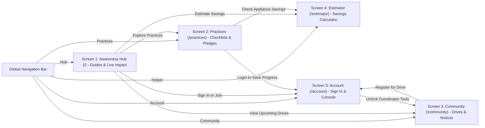

# Chapter 5: UI/UX Design, Multilingual Engine & Wireframe Sketches

**Project Title:** Community Renewable Energy Awareness and Management Portal  
**Course Code:** VTU 1BCP308 — Community / Societal Project  

---

## 5.1 Visual Design System & Accessibility

- **Theme:** Light, high-contrast **Civic-Green & Navy** palette for easy outdoor smartphone legibility:
  - Background: `#F8FAFC` | Card Surface: `#FFFFFF` | Border: `#CBD5E1`
  - Primary Brand Navy: `#0B3C6D` | Accent Teal: `#156594` | Sustainable Green: `#15803D` / `#16A34A`
- **Typography:** Minimum `16px` body copy, clean Unicode Indian script font fallbacks (`Noto Sans` / system fonts), and `Lucide` topic icons.
- **Responsive Breakpoints:** Mobile-first single-column layout (`375px`+) scaling cleanly to 2–3 column grids on tablet/desktop.

---

## 5.2 Multilingual `i18n` Architecture

- Supports **10 Indian languages** via modular lazy-loaded locale files (`en.json`, `kn.json`, `hi.json`, `ta.json`, `te.json`, `ml.json`, `mr.json`, `bn.json`, `gu.json`, `pa.json`).
- Active language is persisted in `localStorage` (and synced to `users.preferred_lang` when signed in).
- Fallback rule: missing keys gracefully fall back to `en.json` so raw key names never appear.
- User-authored `community_drives` and `community_notices` render in their recorded `language_code` with a subtle language badge.

---

## 5.3 Screen Connection Flow & UI Wireframes

- **Figma Design File (Live UI Wireframe Layer):** [Community Renewable Energy Portal - UI Wireframes](https://www.figma.com/design/tJCoLQywqRkmGhJosvMPWk) *(Live in Figma Design canvas with interactive preview)*

### Screen Navigation Architecture (How Screens Connect)

---

### UI Wireframe Specifications (5 Mobile-First Screens)

#### Screen 1: `/` — Public Awareness Hub
* **Route:** `/` *(Open to all visitors, zero login required)*
* **Navigation Bar:** Portal Logo (`C.R.E.A.M.`), Language Dropdown (`English / ಕನ್ನಡ / हिंदी`), `[Sign In / Join]` button.
* **Hero Banner:** "Empowering Communities Through Clean Energy" with primary action buttons: `[Check Practice Readiness ➔]` and `[Explore Local Drives]`.
* **Live Community Impact Strip:** Dynamically queries live database counts:
  * `Members Registered` | `Completed Habits` | `Active Pledges` | `Drive Attendees`
* **Verified Energy Guides (SDG 7, 11, 15):**
  * *Solar PV Assessment:* Shade analysis, space requirements, net metering basics.
  * *Community Biogas & Waste:* Kitchen wet-waste segregation and domestic bio-digestion.
  * *Clean Cooking & Biomass Conservation:* Reducing firewood collection and preserving forest biomass.

#### Screen 2: `/practices` — Practice Checklists & Personal Pledges
* **Route:** `/practices` *(Public viewing; login required to save)*
* **Category Filters:** `All` | `Solar` | `Biogas & Waste` | `Clean Cooking` | `Energy Saving`
* **Interactive Readiness Checklist:**
  * Interactive checkboxes for sustainable habits (e.g. *Inspect shade-free roof 9 AM–3 PM*, *Switch to 9W LEDs*, *Segregate organic kitchen waste*).
  * Saved status badges (`[Saved]`) for logged-in members.
* **My Adoption Pledges Tracker:**
  * Shows user's committed goals with status pills: `Planned`, `In Progress`, `Adopted`.
  * Action button: `[+ Add New Pledge]`.

#### Screen 3: `/community` — Awareness Drives & Local Notices
* **Route:** `/community` *(Public viewing; login required to join drives)*
* **Upcoming Community Drives Board:**
  * Cards displaying: Title, Date, Venue/Location, and Current Attendee Count (e.g. *Ward Solar Workshop — 42 Joined*).
  * Action button: `[Join Awareness Drive]` (increments attendance; one join per member).
  * Empty-state notice when no drives are scheduled.
* **Community Notices & Announcements:**
  * Coordinator announcements (e.g. *KREDL Subsidy Application Camp*, *Municipal Energy Audit Drive*).

#### Screen 4: `/estimator` — Practice & Habit Impact Estimator *(Supporting Tool)*
* **Route:** `/estimator` *(Public, stateless educational helper)*
* **Appliance Input Form:**
  * Old Wattage (W), New Energy-Efficient Wattage (W), Quantity, Hours/Day, Days/Month, Local Tariff (₹/kWh).
  * Action button: `[Calculate Impact]`.
* **Instant Savings Breakdown Display:**
  * Energy Saved: `kWh / month` and `kWh / year`.
  * Money Saved: `₹ / month` and `₹ / year`.
  * Carbon Avoided: `kg CO2 avoided` (based on CEA emission factor of 0.82 kg/kWh).
* **Transparent Physics Formula Box:** Displays the exact formula used so users can verify the calculation.

#### Screen 5: `/account` — Sign In, Member Profile & Coordinator Console
* **Route:** `/account`
* **Authentication View (When Logged Out):**
  * Sign In and Member Sign-Up toggle forms (Name, Email, Password, Preferred Language, Community Area).
  * Public sign-up creates a `member` account by default.
* **Member View (When Logged In):**
  * Displays user profile details, preferred language selector, and saved habit summary.
* **Coordinator Console (Visible Only for Coordinator Role):**
  * Role Badge: `Role: Community Coordinator (Verified)`.
  * Action 1: `[+ Schedule New Community Drive]`
  * Action 2: `[+ Post Community Notice / Update]`
  * Action 3: `[Promote Active Member to Coordinator]`
  * Action 4: `[Export Drive Attendance Report (CSV)]`

