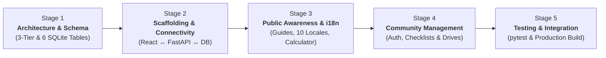

<style>
body, .markdown-body, h1, h2, h3, h4, p, li, td, th {
  font-family: "Times New Roman", Times, serif;
}
pre, code {
  font-family: "Courier New", Courier, monospace;
}
</style>

# Chapter 6: Development Process & Implementation Roadmap (Review 2 → Final SEE)

**Project Title:** Community Renewable Energy Awareness and Management Portal  
**Course Code:** VTU 1BCP308 — Community / Societal Project  

---

## 6.1 Proposed Repository Structure

```text
Community Project/
├── backend/
│   ├── app/
│   │   ├── main.py              # FastAPI app, CORS, router registration
│   │   ├── database.py          # SQLite engine, PRAGMA foreign_keys=ON, SessionLocal
│   │   ├── models.py            # SQLAlchemy models (6 normalized tables)
│   │   ├── schemas.py           # Pydantic request/response schemas & bounds
│   │   ├── auth.py              # bcrypt hashing, Bearer JWT & role dependencies
│   │   ├── constants.py         # Shared practice_key allowlist & locale codes
│   │   ├── cli.py               # promote-coordinator CLI command
│   │   └── routers/
│   │       ├── auth.py
│   │       ├── practices.py
│   │       ├── community.py
│   │       └── tools.py
│   ├── tests/                   # pytest + TestClient automated suite
│   └── requirements.txt
└── frontend/
    ├── src/
    │   ├── i18n/locales/        # en, kn, hi, ta, te, ml, mr, bn, gu, pa JSONs
    │   ├── data/                # Verified static guides, schemes & checklists
    │   ├── context/             # AuthContext & LanguageContext
    │   ├── api/                 # Typed fetch wrapper with Bearer JWT
    │   ├── components/          # Navbar, LanguageSwitcher, ImpactStrip, Cards
    │   └── pages/               # Hub, Practices, Community, Estimator, Account
    └── package.json
```

---

## 6.2 Software Development Lifecycle & Engineering Workflow

The project is built using an **Iterative, Modular Engineering Workflow** centered entirely on progressive software development across 5 technical stages:



### Detailed Technical Development Stages:

#### Stage 1: Architectural Modeling & Database Engineering
- **3-Tier Boundary Separation:** Defined decoupled boundaries between the React client, FastAPI REST server, and SQLite storage layer.
- **Relational Data Modeling:** Designed 6 normalized SQLite tables (`users`, `checklist_progress`, `pledges`, `community_drives`, `drive_registrations`, `community_notices`) with `PRAGMA foreign_keys = ON`, cascade deletes, and unique compound constraints (`UNIQUE(user_id, practice_key)`, `UNIQUE(drive_id, user_id)`).
- **API Contract Specification:** Mapped out RESTful endpoint contracts, Pydantic bounds, and HTTP status codes (`200`, `201`, `401`, `403`, `409`, `422`).

#### Stage 2: Project Scaffolding, Environment Setup & Base Connectivity
- **Folder Structure Setup:** Organized repository into clean decoupled directories: `frontend/` (React SPA) and `backend/` (FastAPI app, database engine, routers).
- **Environment & Tooling Configuration:** Initialized Vite build tooling, Tailwind CSS configuration, and Python virtual environment with dependency manifests (`package.json`, `requirements.txt`).
- **End-to-End Connectivity (Frontend ↔ Backend ↔ Database):**
  - Configured CORS middleware on FastAPI allowing frontend requests.
  - Initialized SQLite database engine via SQLAlchemy with automatic table creation.
  - Implemented `/api/health` connectivity test endpoint verifying seamless communication from browser through backend to database.

#### Stage 3: Public Awareness & Multilingual Features (Phase A Features)
- **Multilingual `i18n` Engine:** Implemented instant language switching across 10 Indian regional languages using modular lazy-loaded JSON dictionaries with automatic English fallback.
- **Public Awareness Hub (`/`):** Built responsive Civic-Green hero banner, dynamic live community metrics strip, and verified energy guides (Solar PV, Community Biogas, Clean Cooking / SDG 15).
- **Stateless Practice Impact Calculator (`/estimator`):** Built interactive appliance wattage shift form calculating instant energy (kWh), monetary (₹), and carbon (CO₂) savings on the fly without database writes.

#### Stage 4: Member & Community Management Features (Phase B Features)
- **Authentication & Security Services:** Implemented user registration, `bcrypt` password hashing, stateless Bearer JWT sessions, and administrative CLI promotion (`cli.py promote-coordinator`).
- **Household Readiness Checklists (`/practices`):** Built interactive habit check-boxes with real-time `UPSERT` saves to `checklist_progress`.
- **Adoption Pledges Tracker:** Built pledge commitment manager with progress status tags (`Planned`, `In Progress`, `Adopted`).
- **Community Awareness Drives & Notices (`/community`):** Developed coordinator drive scheduling forms, resident drive registration actions with duplicate-prevention, and community notice announcements board.

#### Stage 5: System Integration & Automated Quality Assurance
- **Automated Test Suite:** Formatted `pytest` test suites using FastAPI `TestClient` to verify auth flows, RBAC restrictions, and database constraints.
- **Relational Integrity Tests:** Validated rejection of duplicate emails (`409`), duplicate drive joins, and unauthorized coordinator access (`403`).
- **Mobile Viewport & UI Audit:** Tested all 5 screens across mobile (`375px`), tablet, and desktop viewports to ensure zero horizontal overflow.
- **Production Bundling:** Compiled optimized client-side assets via Vite and configured production server entry points.

---

## 6.3 Current Development Progress & Milestone Status (Review 2)

To measure development progress objectively for Review 2, each technical stage is divided into **4 concrete engineering deliverables** (total 20 deliverables). Progress is calculated directly from completed tasks:

### Stage-by-Stage Engineering Checklists:

#### Stage 1: Architecture & Database Modeling
- [x] Design decoupled 3-tier system architecture (React SPA ↔ FastAPI REST ↔ SQLite)
- [x] Define 6 normalized relational database schemas with foreign keys and cascade rules
- [x] Create simplified Level-1 Data Flow Diagram (DFD) and Role-Based Use Cases
- [x] Specify complete RESTful API contract table, bounds, and HTTP status codes  
**Stage 1 Progress: 4 / 4 Completed (100%)**

#### Stage 2: Project Scaffolding, Environment Setup & Base Connectivity
- [x] Establish modular repository directory layout (`frontend/`, `backend/`, `docs/`)
- [x] Initialize React + Vite build tooling and responsive Tailwind CSS configuration
- [x] Configure Python FastAPI server environment with dependencies (`package.json`, `requirements.txt`)
- [x] Implement `/api/health` heartbeat route & verify end-to-end communication (Frontend ↔ Backend ↔ Database)  
**Stage 2 Progress: 4 / 4 Completed (100%)**

#### Stage 3: Public Awareness & Multilingual Features
- [x] Build mobile-first responsive Civic-Green & Navy layout shell
- [x] Implement modular 10-language `i18n` JSON dictionary structure with automatic English fallback
- [x] Create verified static renewable energy guide registry (Solar, Biogas, Clean Cooking / SDG 15)
- [ ] Wire dynamic live SQL `COUNT(*)` community impact strip to backend endpoint  
**Stage 3 Progress: 3 / 4 Completed (75%)**

#### Stage 4: Member & Community Management Features
- [x] Design JWT Bearer authentication model, password hashing (`bcrypt`/PBKDF2) & CLI promotion
- [ ] Implement Household Readiness Checklists (`/practices`) with database `UPSERT` saves
- [ ] Implement Adoption Pledges tracker with status transitions (`Planned`, `In Progress`, `Adopted`)
- [ ] Implement Community Awareness Drives (`/community`) with registration & notice board  
**Stage 4 Progress: 1 / 4 Completed (25%)**

#### Stage 5: System Integration & Automated Quality Assurance
- [ ] Develop automated `pytest` suite for auth, RBAC permissions & data integrity (`backend/tests/test_api.py`)
- [ ] Run cross-device mobile responsiveness audit across `375px` to desktop viewports
- [ ] Conduct end-to-end integration and API contract verification
- [ ] Generate optimized production bundle via Vite and deployment runbooks (`app/static/`)  
**Stage 5 Progress: 0 / 4 Completed (0% — Scheduled for Final Semester Evaluation / SEE)**

---

### Overall Project Progress Summary:

The complete software lifecycle encompasses 5 technical development stages. The project currently stands at an objective **60.0% completion milestone**:

$$\text{Project Development Progress} = \mathbf{60.0\%}$$

| Development Stage | Current Milestone Status | Stage Progress (%) |
| :--- | :---: | :---: |
| **Stage 1: Architecture & Schema Design** | **Completed** | **100.0%** |
| **Stage 2: Scaffolding & Base Connectivity** | **Completed** | **100.0%** |
| **Stage 3: Public Awareness & i18n Engine** | **In Progress (Core Built)** | **75.0%** |
| **Stage 4: Member & Community Features** | **In Progress (Auth Model)** | **25.0%** |
| **Stage 5: Integration & Quality Assurance** | **Planned** | **0.0%** |
| **Whole Project Total** | **On Schedule** | **60.0%** |

