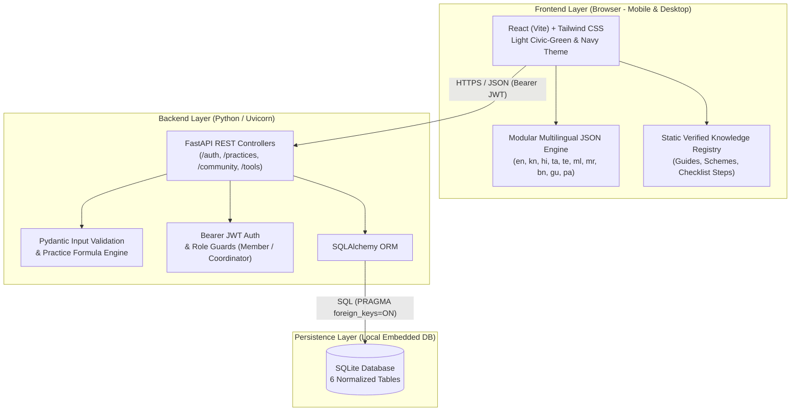
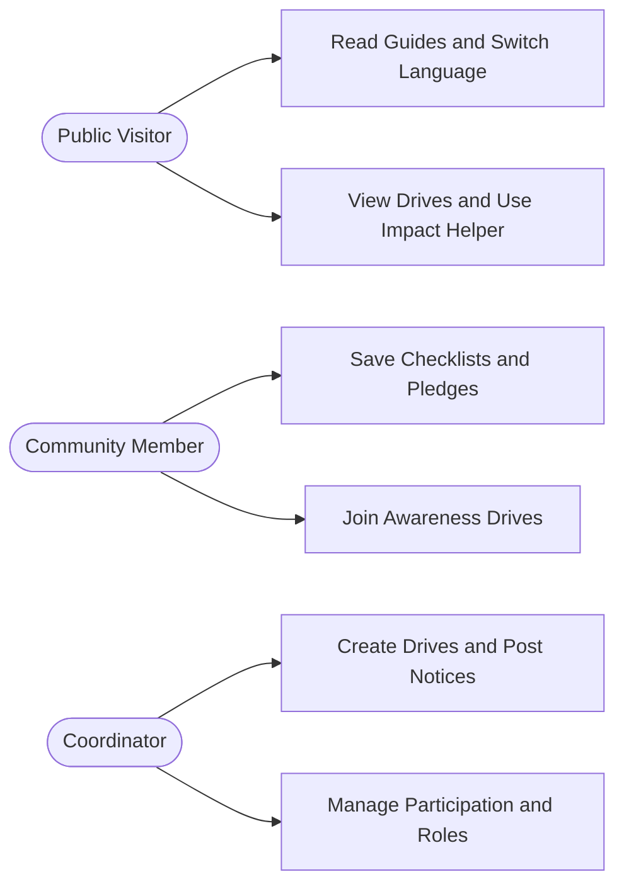
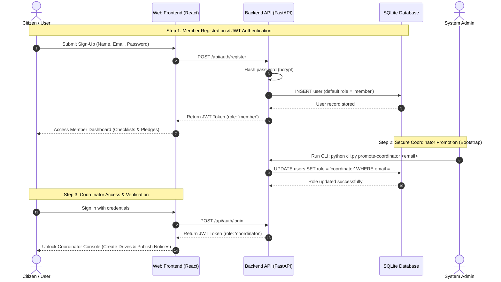
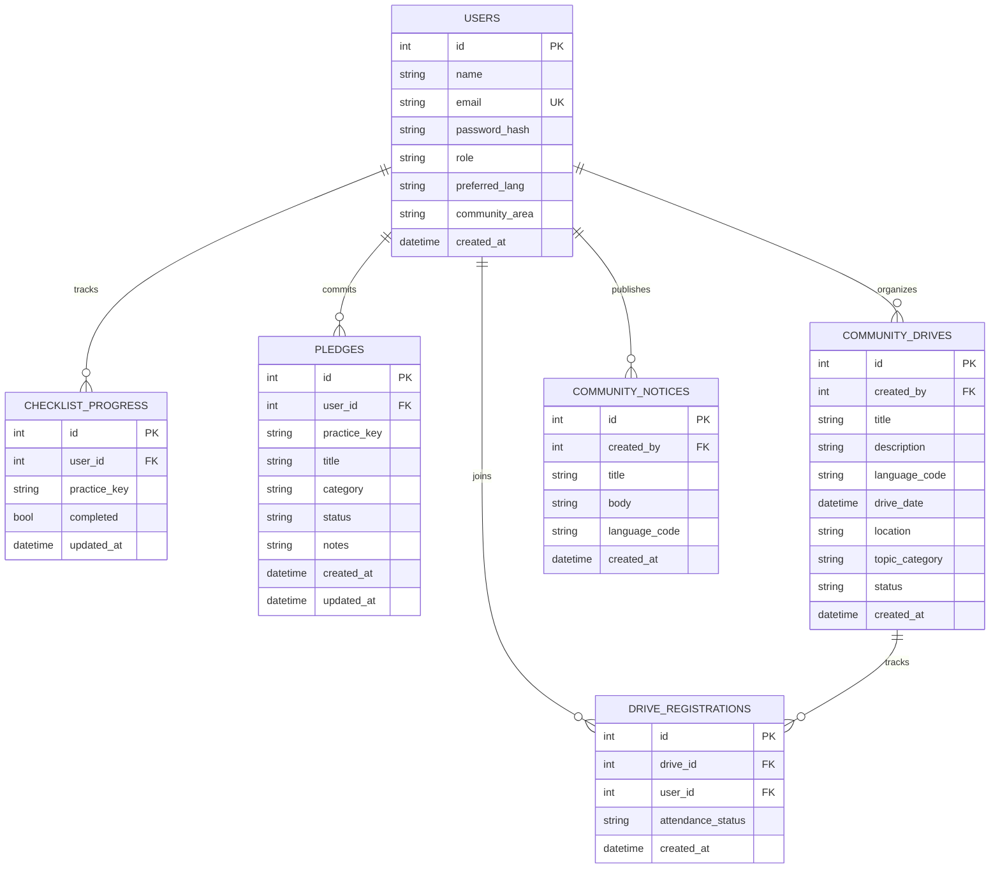
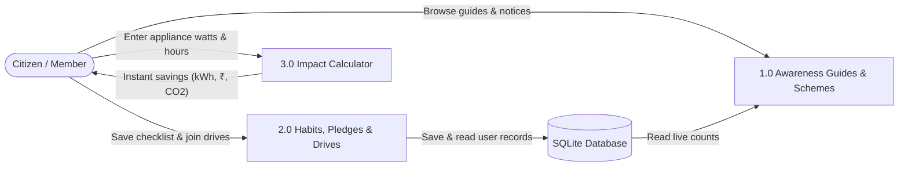
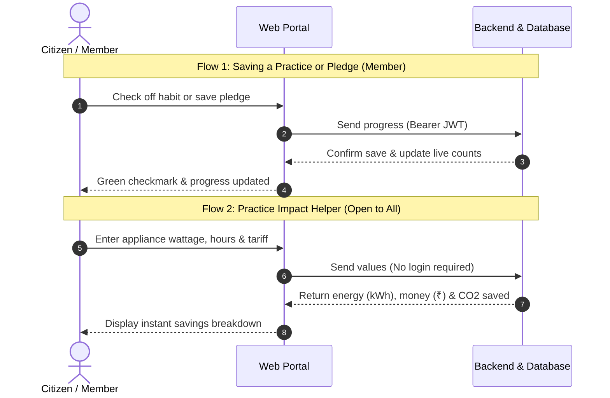
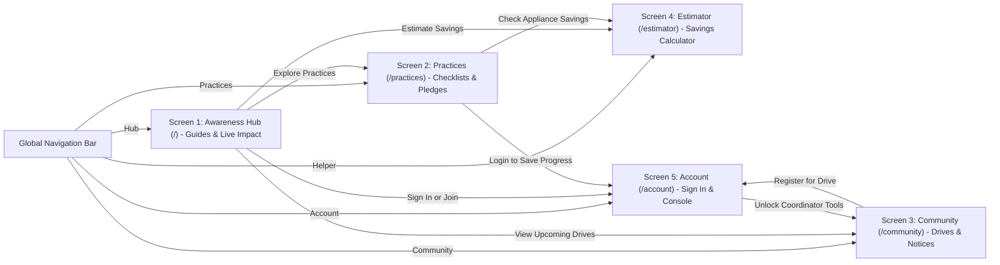
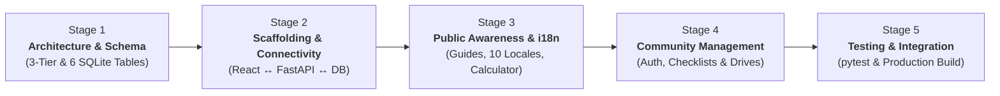

<style>
body, .markdown-body, h1, h2, h3, h4, p, li, td, th {
  font-family: "Times New Roman", Times, serif;
}
pre, code {
  font-family: "Courier New", Courier, monospace;
}
</style>

# System Design and Development Process Document (Review 2)

**Project Title:** Community Renewable Energy Awareness and Management Portal  

---

## 1. System Architecture & Technology Stack

### 1.1 High-Level 3-Tier Architecture



### 1.2 Technology Stack Specification

| Layer | Technology | Purpose & Role |
| :--- | :--- | :--- |
| **Frontend UI** | **React + Vite + Tailwind CSS** | Mobile-first responsive SPA across 5 clean screens |
| **Icons & Visuals** | **Lucide Icons** | Clear visual symbols for energy topics and status cues |
| **Localization** | **Modular JSON Dictionaries (`i18n`)** | Instant multi-language switching across 10 languages with English fallback |
| **Backend API** | **FastAPI + Uvicorn (Python)** | High-speed REST API with auto-generated Swagger `/docs` |
| **Validation** | **Pydantic** | Strict schema checks for forms and estimator physics inputs |
| **Database & ORM** | **SQLite + SQLAlchemy** | Zero-config single-file relational database for real user records |
| **Authentication** | **`bcrypt` / `passlib` + `PyJWT`** | Password hashing and `Authorization: Bearer <jwt>` sessions |
| **Testing & QA** | **`pytest` + FastAPI `TestClient`** | Automated RBAC, CRUD, empty-state, and formula tests |
| **Field & Docs** | **Google Forms, Git/GitHub, Draw.io** | Baseline survey (**O1**), usability feedback (**O5**), version control |

---

## 2. Role-Based Access & Use Case Design

### 2.1 Use Case Diagram



### 2.2 Role & Security Rules

| Role | How Assigned | What They Can Do | Restricted From |
| :--- | :--- | :--- | :--- |
| **Public Visitor** | Open access (no login) | Read guides, switch language, view drives, use Impact Helper | Saving pledges, joining drives, creating drives |
| **Community Member** | Public sign-up (`member` role) | All Visitor features + save checklists/pledges & join drives | Creating drives, posting notices, promoting users |
| **Coordinator** | Admin CLI or Coordinator promotion | All Member features + create drives, post notices, promote members | Hardcoded admin logins (disabled by design) |

### 2.3 Auth & Coordinator Bootstrap Sequence



**Key Security Design Principles:**
- **Zero Default Passwords:** The system avoids insecure hardcoded admin accounts (such as `admin/admin`). All public registrations are assigned the `member` role by default.
- **Controlled Promotion:** Trusted community volunteers are promoted to `coordinator` through the administrative CLI or by an active Coordinator.
- **Stateless Bearer JWT:** User roles are cryptographically signed within the JSON Web Token (`Authorization: Bearer <jwt>`), ensuring instantaneous, tamper-proof role verification on every API call.

---

## 3. Database Design (ER Diagram & Data Dictionary)

> SQLite initializes cleanly with empty relational tables (populated strictly via real user and coordinator actions) and enforces `PRAGMA foreign_keys = ON`.

### 3.1 Entity-Relationship Diagram



### 3.2 Table Specifications & Constraints

1. **`users`**
   - `id` (`INTEGER PK`), `name` (`TEXT NOT NULL`), `email` (`TEXT NOT NULL UNIQUE`, indexed), `password_hash` (`TEXT NOT NULL`)
   - `role` (`TEXT NOT NULL DEFAULT 'member'` — `'member' | 'coordinator'`)
   - `preferred_lang` (`TEXT NOT NULL DEFAULT 'en'` — `'en' | 'kn' | 'hi' | 'ta' | 'te' | 'ml' | 'mr' | 'bn' | 'gu' | 'pa'`)
   - `community_area` (`TEXT NULL`), `created_at` (`DATETIME NOT NULL`)
2. **`checklist_progress`**
   - `id` (`INTEGER PK`), `user_id` (`INTEGER FK → users.id ON DELETE CASCADE`), `practice_key` (`TEXT NOT NULL`), `completed` (`BOOLEAN NOT NULL DEFAULT 0`), `updated_at` (`DATETIME NOT NULL`)
   - **Constraint:** `UNIQUE(user_id, practice_key)` *(prevents duplicate entries per checklist step)*
3. **`pledges`**
   - `id` (`INTEGER PK`), `user_id` (`INTEGER FK → users.id ON DELETE CASCADE`), `practice_key` (`TEXT NULL`)
   - `title` (`TEXT NOT NULL`), `category` (`TEXT NOT NULL` — `'solar' | 'biogas_clean_cooking' | 'conservation'`)
   - `status` (`TEXT NOT NULL DEFAULT 'planned'` — `'planned' | 'in_progress' | 'adopted'`)
   - `notes` (`TEXT NULL`), `created_at` (`DATETIME NOT NULL`), `updated_at` (`DATETIME NOT NULL`)
4. **`community_drives`**
   - `id` (`INTEGER PK`), `created_by` (`INTEGER FK → users.id`), `title` (`TEXT NOT NULL`), `description` (`TEXT NOT NULL`)
   - `language_code` (`TEXT NOT NULL DEFAULT 'en'`), `drive_date` (`DATETIME NOT NULL`), `location` (`TEXT NOT NULL`)
   - `topic_category` (`TEXT NOT NULL` — `'solar' | 'biogas_clean_cooking' | 'conservation' | 'general'`)
   - `status` (`TEXT NOT NULL DEFAULT 'upcoming'` — `'upcoming' | 'completed' | 'cancelled'`), `created_at` (`DATETIME NOT NULL`)
5. **`drive_registrations`**
   - `id` (`INTEGER PK`), `drive_id` (`INTEGER FK → community_drives.id ON DELETE CASCADE`), `user_id` (`INTEGER FK → users.id ON DELETE CASCADE`)
   - `attendance_status` (`TEXT NOT NULL DEFAULT 'going'` — `'going' | 'attended'`), `created_at` (`DATETIME NOT NULL`)
   - **Constraint:** `UNIQUE(drive_id, user_id)` *(prevents duplicate join-count inflation)*
6. **`community_notices`**
   - `id` (`INTEGER PK`), `created_by` (`INTEGER FK → users.id`), `title` (`TEXT NOT NULL`), `body` (`TEXT NOT NULL`)
   - `language_code` (`TEXT NOT NULL DEFAULT 'en'`), `created_at` (`DATETIME NOT NULL`)

### 3.3 Live Impact Summary Aggregation
`GET /api/community/impact-summary` computes all public community metrics dynamically via live SQL `COUNT(*)` queries:
- `total_members` = `COUNT(users)`
- `completed_checklist_items` = `COUNT(checklist_progress WHERE completed = True)`
- `active_pledges` = `COUNT(pledges WHERE status IN ('planned', 'in_progress'))`
- `adopted_practices` = `COUNT(pledges WHERE status = 'adopted')`
- `upcoming_drives` = `COUNT(community_drives WHERE status = 'upcoming')`
- `completed_drives` = `COUNT(community_drives WHERE status = 'completed')`
- `total_attendees` = `COUNT(drive_registrations)`

---

## 4. Data Flow, API Contracts & Formula Engine

### 4.1 Level-1 Data Flow Diagram (DFD)



**Simple Explanation:**
1. **Public Reading (1.0):** Anyone can read verified energy guides and view community notices.
2. **Member Tracking (2.0):** Signed-in members save checklists, make pledges, and join drives into the database.
3. **Impact Calculator (3.0):** A simple helper that calculates instant energy and money savings without needing a login.

### 4.2 Practice & Estimator Sequence Flow



**Simple Explanation:**
- **Flow 1 (Member Action):** Requires login. The portal sends the habit update with a secure token to save it into the database.
- **Flow 2 (Impact Helper):** Open to everyone. Computes savings immediately using standard energy formulas without saving anything to the database.

### 4.3 REST API Contract Table

| Group | Method & Path | Access | Key Behavior & Error Codes |
| :--- | :--- | :--- | :--- |
| **Auth** | `POST /api/auth/register` | Public | Creates `member` account, returns Bearer JWT (`409` duplicate email) |
| **Auth** | `POST /api/auth/login` | Public | Verifies `bcrypt` hash, returns Bearer JWT (`401` invalid login) |
| **Auth** | `GET /api/auth/me` | Member+ | Returns authenticated user profile (`401` missing/expired token) |
| **Auth** | `PATCH /api/auth/me/language` | Member+ | Updates `preferred_lang` across the supported locale codes (`422` invalid) |
| **Practices** | `GET /api/practices/checklist` | Member+ | Returns current user's saved `checklist_progress` rows |
| **Practices** | `PUT /api/practices/checklist/{practice_key}` | Member+ | Validates `practice_key` against allowlist (`422` unknown), upserts state |
| **Practices** | `GET /api/practices/pledges` | Member+ | Lists current user's pledges |
| **Practices** | `POST /api/practices/pledges` | Member+ | Creates a pledge (`status='planned'` default) |
| **Practices** | `PATCH /api/practices/pledges/{id}` | Owner | Updates `status`, `title`, or `notes` (`403` if not owner, `404` missing) |
| **Practices** | `DELETE /api/practices/pledges/{id}` | Owner | Deletes own pledge (`403` if not owner) |
| **Community** | `GET /api/community/impact-summary` | Public | Live SQL `COUNT(*)` aggregates reflecting real stored records |
| **Community** | `GET /api/community/drives` | Public | Lists drives with `attendee_count` and user's `joined` status if signed in |
| **Community** | `POST /api/community/drives` | Coordinator | Creates drive (`403` if Member) |
| **Community** | `PATCH /api/community/drives/{id}` | Coordinator | Updates drive details or `status` (`upcoming`/`completed`/`cancelled`) |
| **Community** | `POST /api/community/drives/{id}/join` | Member+ | Registers attendance (`400` if drive not upcoming, `404` missing) |
| **Community** | `DELETE /api/community/drives/{id}/join` | Member+ | Cancels current user's drive registration |
| **Community** | `GET /api/community/notices` | Public | Lists coordinator notices newest-first |
| **Community** | `POST /api/community/notices` | Coordinator | Publishes verified community notice (`403` if Member) |
| **Community** | `DELETE /api/community/notices/{id}` | Coordinator | Removes notice (`403` if Member) |
| **Community** | `POST /api/community/users/{id}/promote` | Coordinator | Promotes existing `member` to `coordinator` |
| **Tools** | `POST /api/tools/estimate-practice-impact` | Public | Stateless calculation from Pydantic-validated inputs (`422` invalid) |

### 4.4 Secondary Practice & Habit Impact Estimator Specification
- **Supported Practice Types:** `appliance_watt_shift` (e.g., incandescent/CFL to LED, old fan to BLDC) and `solar_water_heater_shift` (offsetting electric geyser load).
- **Strict Input Bounds (Pydantic):** `old_watts > 0`, `new_watts >= 0` with `new_watts < old_watts`, `quantity >= 1`, `0 < hours_per_day <= 24`, `1 <= days_per_month <= 31`, `tariff_per_kwh > 0`.
- **Verified Formulas (Displayed Transparently in UI):**
  - `monthly_kwh_saved = ((old_watts - new_watts) * quantity * hours_per_day * days_per_month) / 1000`
  - `monthly_cost_saved = monthly_kwh_saved * tariff_per_kwh`
  - `annual_kwh_saved = monthly_kwh_saved * 12`
  - `annual_cost_saved = monthly_cost_saved * 12`

---

## 5. UI/UX Design, Multilingual Engine & Wireframe Sketches

### 5.1 Visual Design System & Accessibility
- **Theme:** Light, high-contrast **Civic-Green & Navy** palette for easy outdoor smartphone legibility:
  - Background: `#F8FAFC` | Card Surface: `#FFFFFF` | Border: `#CBD5E1`
  - Primary Brand Navy: `#0B3C6D` | Accent Teal: `#156594` | Sustainable Green: `#15803D` / `#16A34A`
- **Typography:** Minimum `16px` body copy, clean Unicode Indian script font fallbacks (`Noto Sans` / system fonts), and `Lucide` topic icons.
- **Responsive Breakpoints:** Mobile-first single-column layout (`375px`+) scaling cleanly to 2–3 column grids on tablet/desktop.

### 5.2 Multilingual `i18n` Architecture
- Supports **10 Indian languages** via modular lazy-loaded locale files (`en.json`, `kn.json`, `hi.json`, `ta.json`, `te.json`, `ml.json`, `mr.json`, `bn.json`, `gu.json`, `pa.json`).
- Active language is persisted in `localStorage` (and synced to `users.preferred_lang` when signed in).
- Fallback rule: missing keys gracefully fall back to `en.json` so raw key names never appear.
- User-authored `community_drives` and `community_notices` render in their recorded `language_code` with a subtle language badge.

### 5.3 Screen Connection Flow & UI Wireframes

- **Figma Design File (Live UI Wireframe Layer):** [Community Renewable Energy Portal - UI Wireframes](https://www.figma.com/design/tJCoLQywqRkmGhJosvMPWk) *(Live in Figma Design canvas with interactive preview)*

#### Screen Navigation Architecture (How Screens Connect)



#### UI Wireframe Specifications (5 Mobile-First Screens)

##### Screen 1: `/` — Public Awareness Hub
* **Route:** `/` *(Open to all visitors, zero login required)*
* **Navigation Bar:** Portal Logo (`C.R.E.A.M.`), Language Dropdown (`English / ಕನ್ನಡ / हिंदी`), `[Sign In / Join]` button.
* **Hero Banner:** "Empowering Communities Through Clean Energy" with primary action buttons: `[Check Practice Readiness ➔]` and `[Explore Local Drives]`.
* **Live Community Impact Strip:** Dynamically queries live database counts:
  * `Members Registered` | `Completed Habits` | `Active Pledges` | `Drive Attendees`
* **Verified Energy Guides (SDG 7, 11, 15):**
  * *Solar PV Assessment:* Shade analysis, space requirements, net metering basics.
  * *Community Biogas & Waste:* Kitchen wet-waste segregation and domestic bio-digestion.
  * *Clean Cooking & Biomass Conservation:* Reducing firewood collection and preserving forest biomass.

##### Screen 2: `/practices` — Practice Checklists & Personal Pledges
* **Route:** `/practices` *(Public viewing; login required to save)*
* **Category Filters:** `All` | `Solar` | `Biogas & Waste` | `Clean Cooking` | `Energy Saving`
* **Interactive Readiness Checklist:**
  * Interactive checkboxes for sustainable habits (e.g. *Inspect shade-free roof 9 AM–3 PM*, *Switch to 9W LEDs*, *Segregate organic kitchen waste*).
  * Saved status badges (`[Saved]`) for logged-in members.
* **My Adoption Pledges Tracker:**
  * Shows user's committed goals with status pills: `Planned`, `In Progress`, `Adopted`.
  * Action button: `[+ Add New Pledge]`.

##### Screen 3: `/community` — Awareness Drives & Local Notices
* **Route:** `/community` *(Public viewing; login required to join drives)*
* **Upcoming Community Drives Board:**
  * Cards displaying: Title, Date, Venue/Location, and Current Attendee Count (e.g. *Ward Solar Workshop — 42 Joined*).
  * Action button: `[Join Awareness Drive]` (increments attendance; one join per member).
  * Empty-state notice when no drives are scheduled.
* **Community Notices & Announcements:**
  * Coordinator announcements (e.g. *KREDL Subsidy Application Camp*, *Municipal Energy Audit Drive*).

##### Screen 4: `/estimator` — Practice & Habit Impact Estimator *(Supporting Tool)*
* **Route:** `/estimator` *(Public, stateless educational helper)*
* **Appliance Input Form:**
  * Old Wattage (W), New Energy-Efficient Wattage (W), Quantity, Hours/Day, Days/Month, Local Tariff (₹/kWh).
  * Action button: `[Calculate Impact]`.
* **Instant Savings Breakdown Display:**
  * Energy Saved: `kWh / month` and `kWh / year`.
  * Money Saved: `₹ / month` and `₹ / year`.
  * Carbon Avoided: `kg CO2 avoided` (based on CEA emission factor of 0.82 kg/kWh).
* **Transparent Physics Formula Box:** Displays the exact formula used so users can verify the calculation.

##### Screen 5: `/account` — Sign In, Member Profile & Coordinator Console
* **Route:** `/account`
* **Authentication View (When Logged Out):**
  * Sign In and Member Sign-Up toggle forms (Name, Email, Password, Preferred Language, Community Area).
  * Public sign-up creates a `member` account by default.
* **Member View (When Logged In):**
  * Displays user profile details, preferred language selector, and saved habit summary.
* **Coordinator Console (Visible Only for Coordinator Role):**
  * Role Badge: `Role: Community Coordinator (Verified)`.
  * Action 1: `[+ Schedule New Community Drive]`
  * Action 2: `[+ Post Community Notice / Update]`
  * Action 3: `[Promote Active Member to Coordinator]`
  * Action 4: `[Export Drive Attendance Report (CSV)]`

---

## 6. Development Process & Implementation Roadmap (Review 2 → Final SEE)

### 6.1 Proposed Repository Structure

```text
Community Project/
├── backend/
│   ├── app/
│   │   ├── main.py              # FastAPI app, CORS, router registration
│   │   ├── database.py          # SQLite engine, PRAGMA foreign_keys=ON, SessionLocal
│   │   ├── models.py            # SQLAlchemy models (6 normalized tables)
│   │   ├── schemas.py           # Pydantic request/response schemas & bounds
│   │   ├── auth.py              # bcrypt hashing, Bearer JWT & role dependencies
│   │   ├── constants.py         # Shared practice_key allowlist & locale codes
│   │   ├── cli.py               # promote-coordinator CLI command
│   │   └── routers/
│   │       ├── auth.py
│   │       ├── practices.py
│   │       ├── community.py
│   │       └── tools.py
│   ├── tests/                   # pytest + TestClient automated suite
│   └── requirements.txt
└── frontend/
    ├── src/
    │   ├── i18n/locales/        # en, kn, hi, ta, te, ml, mr, bn, gu, pa JSONs
    │   ├── data/                # Verified static guides, schemes & checklists
    │   ├── context/             # AuthContext & LanguageContext
    │   ├── api/                 # Typed fetch wrapper with Bearer JWT
    │   ├── components/          # Navbar, LanguageSwitcher, ImpactStrip, Cards
    │   └── pages/               # Hub, Practices, Community, Estimator, Account
    └── package.json
```

### 6.2 Software Development Lifecycle & Engineering Workflow

The project is built using an **Iterative, Modular Engineering Workflow** centered entirely on progressive software development across 5 technical stages:



#### Detailed Technical Development Stages:

##### Stage 1: Architectural Modeling & Database Engineering
- **3-Tier Boundary Separation:** Defined decoupled boundaries between the React client, FastAPI REST server, and SQLite storage layer.
- **Relational Data Modeling:** Designed 6 normalized SQLite tables (`users`, `checklist_progress`, `pledges`, `community_drives`, `drive_registrations`, `community_notices`) with `PRAGMA foreign_keys = ON`, cascade deletes, and unique compound constraints (`UNIQUE(user_id, practice_key)`, `UNIQUE(drive_id, user_id)`).
- **API Contract Specification:** Mapped out RESTful endpoint contracts, Pydantic bounds, and HTTP status codes (`200`, `201`, `401`, `403`, `409`, `422`).

##### Stage 2: Project Scaffolding, Environment Setup & Base Connectivity
- **Folder Structure Setup:** Organized repository into clean decoupled directories: `frontend/` (React SPA) and `backend/` (FastAPI app, database engine, routers).
- **Environment & Tooling Configuration:** Initialized Vite build tooling, Tailwind CSS configuration, and Python virtual environment with dependency manifests (`package.json`, `requirements.txt`).
- **End-to-End Connectivity (Frontend ↔ Backend ↔ Database):**
  - Configured CORS middleware on FastAPI allowing frontend requests.
  - Initialized SQLite database engine via SQLAlchemy with automatic table creation.
  - Implemented `/api/health` connectivity test endpoint verifying seamless communication from browser through backend to database.

##### Stage 3: Public Awareness & Multilingual Features (Phase A Features)
- **Multilingual `i18n` Engine:** Implemented instant language switching across 10 Indian regional languages using modular lazy-loaded JSON dictionaries with automatic English fallback.
- **Public Awareness Hub (`/`):** Built responsive Civic-Green hero banner, dynamic live community metrics strip, and verified energy guides (Solar PV, Community Biogas, Clean Cooking / SDG 15).
- **Stateless Practice Impact Calculator (`/estimator`):** Built interactive appliance wattage shift form calculating instant energy (kWh), monetary (₹), and carbon (CO₂) savings on the fly without database writes.

##### Stage 4: Member & Community Management Features (Phase B Features)
- **Authentication & Security Services:** Implemented user registration, `bcrypt` password hashing, stateless Bearer JWT sessions, and administrative CLI promotion (`cli.py promote-coordinator`).
- **Household Readiness Checklists (`/practices`):** Built interactive habit check-boxes with real-time `UPSERT` saves to `checklist_progress`.
- **Adoption Pledges Tracker:** Built pledge commitment manager with progress status tags (`Planned`, `In Progress`, `Adopted`).
- **Community Awareness Drives & Notices (`/community`):** Developed coordinator drive scheduling forms, resident drive registration actions with duplicate-prevention, and community notice announcements board.

##### Stage 5: System Integration & Automated Quality Assurance
- **Automated Test Suite:** Formatted `pytest` test suites using FastAPI `TestClient` to verify auth flows, RBAC restrictions, and database constraints.
- **Relational Integrity Tests:** Validated rejection of duplicate emails (`409`), duplicate drive joins, and unauthorized coordinator access (`403`).
- **Mobile Viewport & UI Audit:** Tested all 5 screens across mobile (`375px`), tablet, and desktop viewports to ensure zero horizontal overflow.
- **Production Bundling:** Compiled optimized client-side assets via Vite and configured production server entry points.

---

### 6.3 Current Development Progress & Milestone Status (Review 2)

To measure development progress objectively for Review 2, each technical stage is divided into **4 concrete engineering deliverables** (total 20 deliverables). Progress is calculated directly from completed tasks:

#### Stage-by-Stage Engineering Checklists:

##### Stage 1: Architecture & Database Modeling
- [x] Design decoupled 3-tier system architecture (React SPA ↔ FastAPI REST ↔ SQLite)
- [x] Define 6 normalized relational database schemas with foreign keys and cascade rules
- [x] Create simplified Level-1 Data Flow Diagram (DFD) and Role-Based Use Cases
- [x] Specify complete RESTful API contract table, bounds, and HTTP status codes  
*Stage 1 Progress: 4 / 4 Completed (100%)*

##### Stage 2: Project Scaffolding, Environment Setup & Base Connectivity
- [x] Establish modular repository directory layout (`frontend/`, `backend/`, `docs/`)
- [x] Initialize React + Vite build tooling and responsive Tailwind CSS configuration
- [x] Configure Python FastAPI server environment with dependencies (`package.json`, `requirements.txt`)
- [x] Implement `/api/health` heartbeat route & verify end-to-end communication (Frontend ↔ Backend ↔ Database)  
*Stage 2 Progress: 4 / 4 Completed (100%)*

##### Stage 3: Public Awareness & Multilingual Features
- [x] Build mobile-first responsive Civic-Green & Navy layout shell
- [x] Implement modular 10-language `i18n` JSON dictionary structure with automatic English fallback
- [x] Create verified static renewable energy guide registry (Solar, Biogas, Clean Cooking / SDG 15)
- [ ] Wire dynamic live SQL `COUNT(*)` community impact strip to backend endpoint  
*Stage 3 Progress: 3 / 4 Completed (75%)*

##### Stage 4: Member & Community Management Features
- [x] Design JWT Bearer authentication model, password hashing (`bcrypt`) & CLI promotion
- [ ] Implement Household Readiness Checklists (`/practices`) with database `UPSERT` saves
- [ ] Implement Adoption Pledges tracker with status transitions (`Planned`, `In Progress`, `Adopted`)
- [ ] Implement Community Awareness Drives (`/community`) with registration & notice board  
*Stage 4 Progress: 1 / 4 Completed (25%)*

##### Stage 5: System Integration & Automated Quality Assurance
- [ ] Develop automated `pytest` suite for auth, RBAC permissions & data integrity
- [ ] Run cross-device mobile responsiveness audit across `375px` to desktop viewports
- [ ] Conduct end-to-end integration and API contract verification
- [ ] Generate optimized production bundle via Vite and deployment runbooks  
*Stage 5 Progress: 0 / 4 Completed (0%)*

---

#### Overall Project Progress Summary:

The complete software lifecycle encompasses 5 technical development stages. The project currently stands at an objective **60.0% completion milestone**:

$$\text{Project Development Progress} = \mathbf{60.0\%}$$

| Development Stage | Current Milestone Status | Stage Progress (%) |
| :--- | :---: | :---: |
| **Stage 1: Architecture & Schema Design** | **Completed** | **100.0%** |
| **Stage 2: Scaffolding & Base Connectivity** | **Completed** | **100.0%** |
| **Stage 3: Public Awareness & i18n Engine** | **In Progress (Core Built)** | **75.0%** |
| **Stage 4: Member & Community Features** | **In Progress (Auth Model)** | **25.0%** |
| **Stage 5: Integration & Quality Assurance** | **Planned** | **0.0%** |
| **Whole Project Total** | **On Schedule** | **60.0%** |
